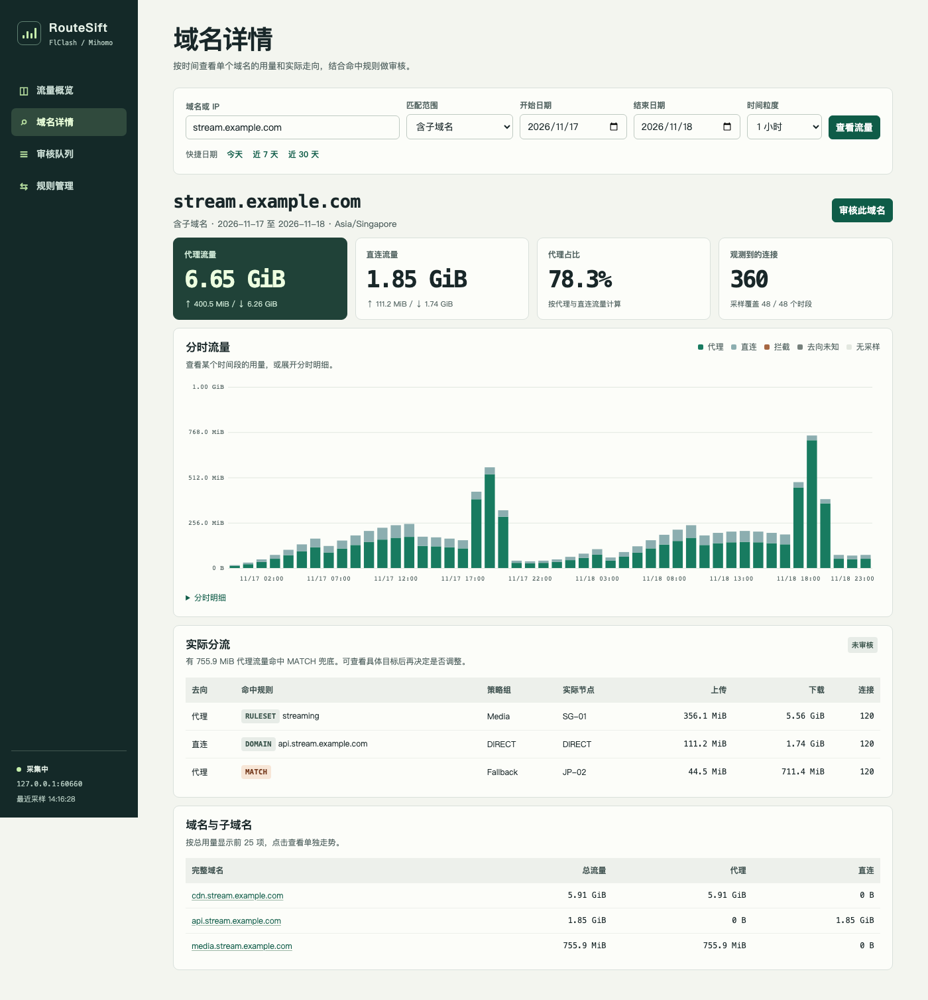

# RouteSift

**追踪每个域名的流量走势，查清实际分流，再把审核结论导出成规则。**

Local traffic analytics and rule review for FlClash and Mihomo. Inspect domain-level bandwidth over time, see which routing policies handled it, and export reviewed decisions as Mihomo rule providers.



*截图使用合成流量。*

## 可以用 RouteSift 做什么

| 问题 | 在哪看 |
| --- | --- |
| 某个域名今天什么时候开始大量走代理？ | 打开「域名详情」，选择精确域名或含子域名，按 5 分钟、1 小时或 1 天查看上传、下载、代理和直连流量。 |
| 这段流量为什么走了这条线路？ | 在「实际分流」看命中规则、策略组和节点。流量概览还提供域名和进程排行、MATCH 兜底榜、流量频次四象限和单日突发。 |
| 已经确认这个目标可以直连，怎么加规则？ | 从域名详情或审核队列保存决策。RouteSift 通过本机 HTTP 接口生成规则集，由 FlClash 或其他 Mihomo 客户端更新。 |

## 快速开始 · Quick start

需要 **macOS 或 Linux**、**Python 3.11+** 和正在运行的 **Mihomo 内核**。

在 FlClash 打开「外部控制器」。FlClash 0.8.92 中，开关位于「工具 → 基本配置」底部，开启后监听 `127.0.0.1:9090`。其他 Mihomo 客户端在内核配置中设置本机 `external-controller`。 [FlClash 设置源码](https://github.com/chen08209/FlClash/blob/v0.8.92/lib/views/config/general.dart#L388-L433) · [Mihomo API 文档](https://wiki.metacubex.one/en/api/)

```sh
git clone https://github.com/askxiaozhang/RouteSift.git
cd RouteSift
python3 -m venv .venv
.venv/bin/python -m pip install -r requirements.txt
cp -n .env.example .env
chmod 600 .env
.venv/bin/python server.py
```

打开 [本机看板](http://127.0.0.1:18765)。如果控制器设了密钥，在启动前把相同的值填进 `.env`。首次连接成功后，看板会显示「采集中」。可以从「流量概览」点击现有目标，也可在「域名详情」输入具体域名。

Enable your client's loopback controller, run the commands above, then open the dashboard. Set `MIHOMO_SECRET` in `.env` if your controller requires authentication.

| 环境变量 | 默认值 | 用途 |
| --- | --- | --- |
| `MIHOMO_URL` | `ws://127.0.0.1:9090/connections` | Mihomo 的 WebSocket 地址 |
| `MIHOMO_SECRET` | 空 | 外部控制器的 Bearer 密钥 |
| `AUDITOR_PORT` | `18765` | 本机看板和规则接口端口 |
| `AUDITOR_DB` | `data/traffic.db` | 流量和审核记录的 SQLite 路径 |

## 把审核结论加进 FlClash

1. 在「域名详情」或「审核队列」选择一个目标。先查看流量走势和命中规则，再决定分流方式。规则支持精确域名、域名后缀、进程名和 IP / CIDR。
2. 保存审核结论。已审核目标默认从候选和代理分析中折叠，可通过「显示已审核」继续查看。
3. 在「规则管理」下载覆写脚本。将它导入当前 FlClash 配置的扩展脚本并启用脚本模式。已有 `main(config)` 时，将下载脚本中的逻辑合并进去，再重新应用配置。
4. 检查 FlClash 是否加载了三个 `traffic-auditor-*` 提供者。FlClash 每 5 分钟更新一次规则集，也可手动更新。修改或撤销审核后，更新规则提供者即可应用最新规则。已建立的连接可能继续沿用原有分流。

| 审核结论 | 生效方式 |
| --- | --- |
| `DIRECT` | 命中时直连 |
| `KEEP_PROXY` | 命中时跳过 RouteSift 新增的分流，交回原配置处理 |
| `REJECT` | 命中时拦截 |
| `IGNORE` | 只影响审核筛选 |

多个审核目标重叠时，保留原分流优先，其次拦截、直连。其他 Mihomo 客户端可参考 [覆写脚本](deploy/flclash-override.js) 配置相同的 HTTP rule providers 和规则顺序。规则集使用 [Mihomo classical YAML 格式](https://wiki.metacubex.one/en/config/rule-providers/)。

## 数据和采样口径

- RouteSift 从 `/connections` 读取活跃连接快照，按连接 ID 算流量增量，以 5 分钟窗口聚合到 SQLite。窗口切换、约每 15 秒或正常退出时批量落库。连接基线与流量增量同事务保存，重连或重启可以续算。
- 新观测到的连接按首帧累计值入账，可能包含采样前产生的流量。两帧之间结束的连接以及最后一帧之后的尾流量可能漏采。趋势图的灰色区间代表无采样。
- 完整域名和子域名可以分别统计。主域名归并使用离线公共后缀表。没有域名的连接按目标 IP 记录，缺失代理链的流量归入「去向未知」。
- 频次以观察到代理字节的自然日计数。突发分析对比昨天与采样覆盖相近的历史日期，至少需要 7 个可比日期。
- 看板和规则接口只绑定本机回环地址。流量、审核结论和连接基线存放于本地 SQLite。

## 常驻运行

**macOS**　将 [launchd 模板](deploy/com.flclash.auditor.plist) 中的 `WORKSPACE_PATH` 替换为项目绝对路径。创建项目下的 `data/`，将修改后的模板保存到 `~/Library/LaunchAgents/com.flclash.auditor.plist`。退出前台进程后加载。

```sh
launchctl bootstrap "gui/$(id -u)" "$HOME/Library/LaunchAgents/com.flclash.auditor.plist"
```

停止时运行 `launchctl bootout "gui/$(id -u)/com.flclash.auditor"`。

**Linux**　按实际路径修改 [systemd 用户服务模板](deploy/flclash-auditor.service) 的 `WorkingDirectory` 与 `ExecStart`，保存为 `~/.config/systemd/user/flclash-auditor.service`，退出前台进程后运行下列命令。

```sh
systemctl --user daemon-reload
systemctl --user enable --now flclash-auditor.service
```

## 排查与开发

- **控制器尚未监听**　检查客户端是否启动内核并开启了外部控制器，以及 `MIHOMO_URL` 的端口是否一致。
- **鉴权失败**　检查 `MIHOMO_SECRET` 是否和控制器一致。修改 `.env` 后重启 RouteSift。
- **进程列为空**　在代理客户端开启「查找进程」，然后检查后续采样。
- **精确域名没有数据**　切换到「含子域名」，检查流量是否发往 API、CDN 等子域名。

[采集](collector.py)负责快照与增量，[存储](storage.py)负责 SQLite 和审核记录，[分析](analyzer.py)与[域名详情](domain_insights.py)负责聚合，[服务](server.py)托管[看板](static/index.html)和[规则导出](rule_exporter.py)。

## License

[MIT](LICENSE)
